# 4D Radar Simulator for Human Activity Recognition [with MATLAB Code]

Introduction: With the aging population, monitoring the health of the elderly has become an important issue. Among the products popular in the market, wearable devices are a competitive technology for health monitoring, but their invasiveness, fragility, and necessity for battery power sometimes limit their application scope. Wearable devices also have compliance weaknesses because they must be worn to be effective. People forget to wear them when living with cognitive decline or simply do not want to wear them. In the competition with wearable technology, due to the attractiveness of radars, electromagnetic waves have become one of the most effective indoor monitoring modes, including its non-blocking lighting, non-intrusive sensing, insensitive to lighting conditions, and privacy protection [1].
In the field of human activity recognition (HAR), 4D MIMO Frequency Modulated Continuous Wave (FMCW) radar is an ideal choice compared to pulse radars, which do not have blind spots. 4D refers to distance, speed, azimuth angle, and elevation angle, providing complete information about the target's velocity and position in 3D space [2]. Although many researchers have been studying classification models related to deep learning, more work is expected to focus on signal preprocessing to improve classification accuracy, especially for 4D radars, as their geometric shape, hardware, and signal processing techniques may differ.
The mainstream method for implementing activity recognition is the use of micro Doppler (mD) signatures. The author comprehensively explains mD signals in Reference [3], and illustrates this phenomenon by explaining the kinematic features observed in the signals and the motions of humans, four-legged animals, and birds observed by radar. The focus is on establishing a simplified continuous wave radar phase delay model with vectorized line of sight range bins. To simulate the mD phenomenon as described in Reference [3], a vector is defined to represent the distances divided into range bins. The distance bins reflect the radar's range resolution, which is defined by the signal's bandwidth. The radar system needs to process the received signals, for FMCW radars, this processing is stretching, or for fully digitalized signals, it is pulse compression to obtain the target's range information. In Reference [3], the author calculates the reflection amplitude based on standard geometric shapes (such as ellipsoids and spheres), and determines which distance bin the target will fall into based on the distance from the radar to the target. Then, the phase delay is calculated at that distance bin. At that point, Dirac points with the calculated amplitude and phase are added in polar coordinates. This is a "shortcut" to reduce computational load compared to full wave simulation, but it means that original data and range information cannot be utilized because they do not represent radar operation. In Reference [4], it is indicated that the algorithm for full wave simulation is more computationally intensive than the one in Reference [3]. However, it provides more detail in simulating mD characteristics, especially during acceleration and deceleration stages [4]. In Reference [5], the author also used mD signatures and benchmarked classification performance as a function of azimuth angle through comparing eight radar systems. The author has already proven in Reference [5] that monostatic radar systems perform best in recognizing activities when the target's azimuth angle is less than 30°, while multistatic and interferometric radar geometries can consistently recognize activities throughout the range change. Therefore, we choose to focus on centralized MIMO radar for simulation. Shelly designed an open-source simulation tool for creating micro Doppler data in passive WiFi radar scenarios [6], and using the full wave emulator's simulated data shows an improvement of 8% compared to using real mD signatures.
In the literature [7], the authors proposed a hierarchical active classification method, incorporating 13 features extracted from Doppler spectra, including energy characteristics, physical characteristics, image-based features, rhythmograms, and singular value decomposition features. They achieved an accuracy of 95.4% in classifying six activities. However, one common issue with using mD signatures is that features should be carefully handpicked based on the dataset, which limits the algorithm's generalizability. Additionally, by employing a 2D antenna array, micro-Doppler simulation can be extrapolated to 4D radar. Adding other data representations from the distance domain allows us to extract point clouds, providing more accurate information about detected targets. Building on the RDS method, a high-quality imaging range motion compensation method based on Keystone transformation is proposed. Furthermore, an adaptive threshold two-dimensional constant false alarm rate (CFAR) detection method is employed for localization of extended targets in the range-Doppler map (RDM). In [9], the authors selected eight activities from the Carnegie Mellon University MOCAP dataset and generated point clouds by extracting isosurfaces from the radar-Doppler-time (range-Doppler time (RDT)) matrix.
The method segments the human body into its parts through grayscale and retains the contour of the RDM for surface extraction. While this approach simplifies computational complexity, it may lead to the loss of RDM information. The algorithm preserves the entire RDM information after two-dimensional constant false alarm filtering, avoiding information loss, rather than segmenting the body parts.
The traditional method for processing point clouds is to match the cloud points with human skeletons. The author utilized millimeter-wave radar in [10] to identify the main movements of the human body and detected and monitored 15 independent bone joints through radar reflection signal detection and monitoring. Using the radar-image representation method, the normalized values of distance, angle, and power level at each position were assigned to the RGB channels. Finally, a split CNN architecture was used to predict the accurate positions of the bone joints in three-dimensional space and ultimately recognize the human movement. However, this method is unreliable because it often fails to capture some bone reflections. PointNet was proposed in 2016 as a deep learning architecture that directly processes point cloud data. Its main idea is to use shared multi-layer perception to extract global features and output k scores, where k is the number of categories. The network greatly preserves the rotation invariance and arrangement invariance of the point cloud by applying T-networks and max-pooling. In addition to direct methods for processing point clouds, other known representations of point cloud data include voxelization and table-based representation. However, both methods have their drawbacks. After voxelization, crowded voxels can lead to information loss, while empty voxels increase unnecessary computations [12]. Compared to voxelization, table-based representation saves more storage space and allows more features, but when the number of point clouds is large, sorting and filling processes are complex [13]. Therefore, this paper applies PointNet to classify four human activities, achieving an average classification accuracy of 90%.
In summary, the main contributions are as follows:
1. A 4D Time Division Multiple Access (TDM) radar emulator was proposed, which can simulate all radar data representation domains including raw data, distance-time, spectrum plot, distance-Doppler, and distance-angle, using MIMO CFAR detection.
2. The paper proposes a distance-Doppler-time representation method based on the 4D TDM MIMO radar simulator, utilizing 2D MIMO CFAR to automatically extract the interested region for activity recognition, including jumps, kicks, punches, and walks, and employing specific sampling input into PointNet to achieve a classification accuracy of 90%, verifying the correctness of our radar model.
Thesis illustration
Conclusion In this paper, we establish a four-dimensional TDM radar model with 12 Tx and 16 Rx antennas, capable of simulating MIMO radar signal processing. We obtained profiles of distance-time, spectrum, distance-Doppler, and distance-angle, validating that MIMO 2D OS-CFAR performs better than CA-CFAR. Using the HDM 05 mocap dataset, we generated human skeleton models and selected activities such as jumps, Jacks, kicks, punches, and walking through the RDT algorithm to create point clouds. Selecting PointNet as the classification network for point clouds, the average classification accuracy reached 90%.
Code list

## Images

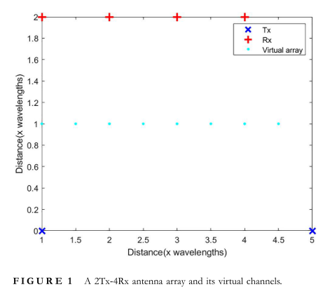
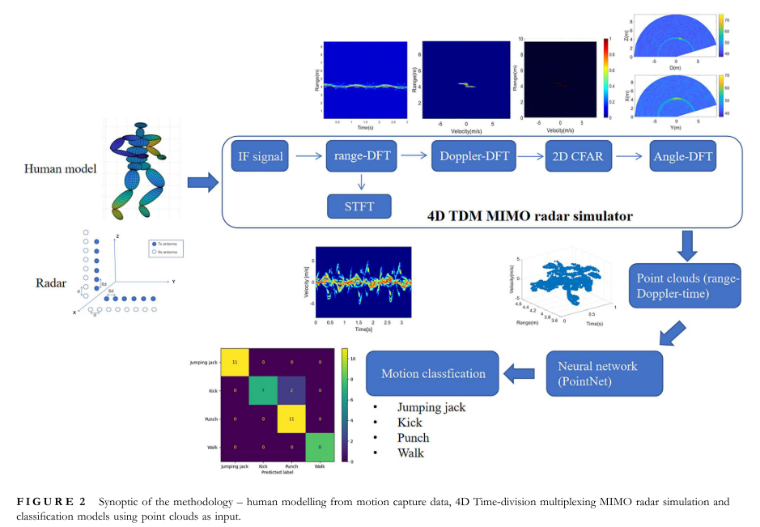
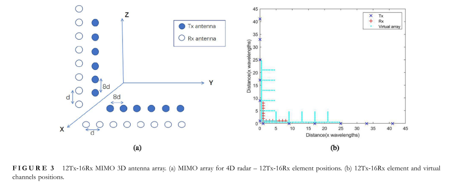
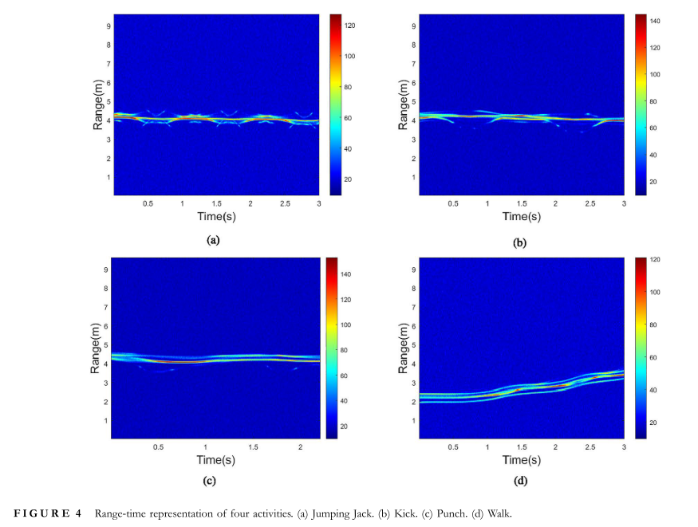
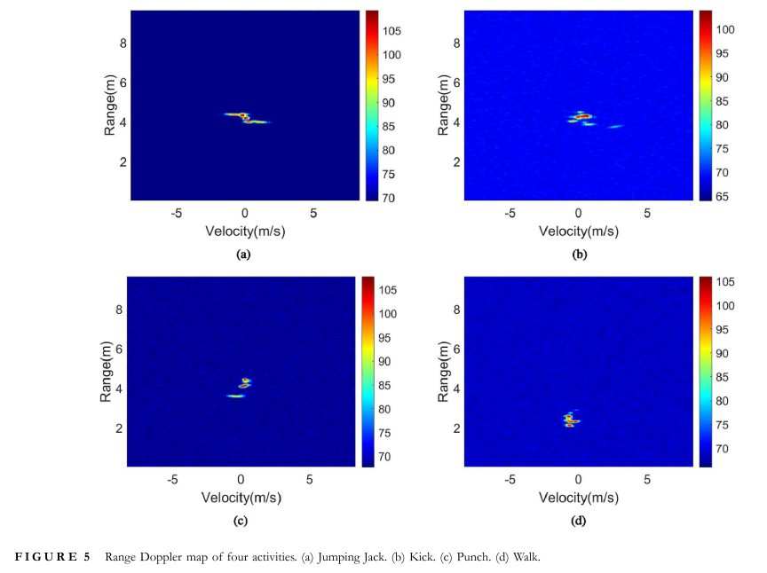
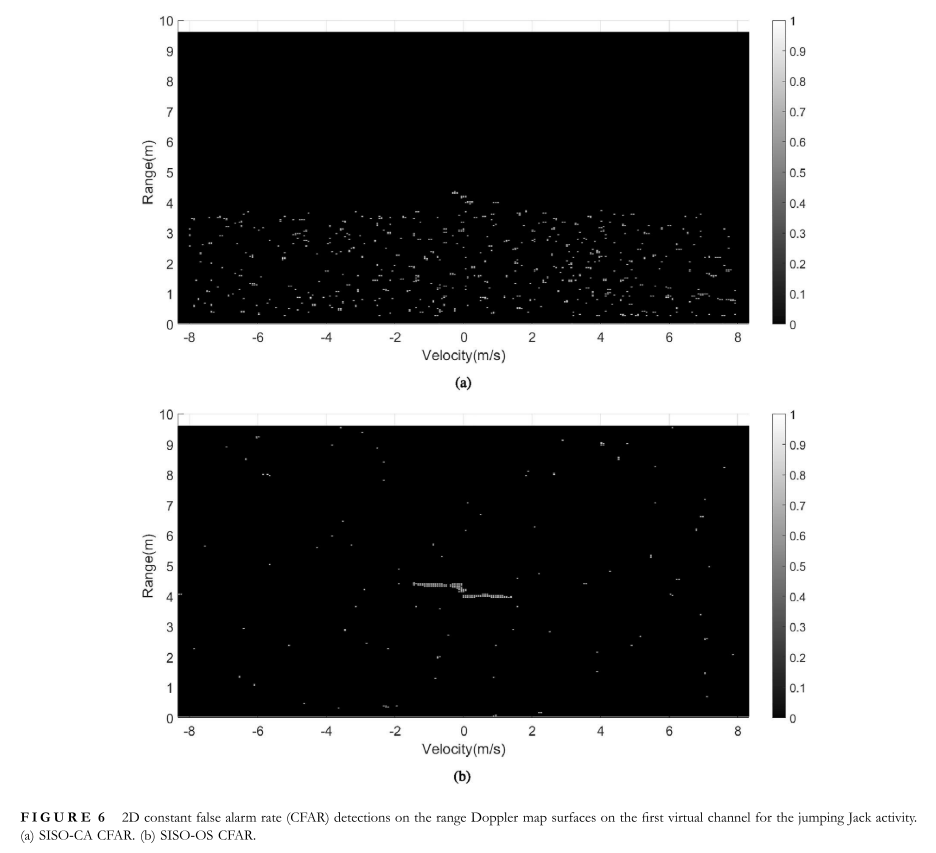
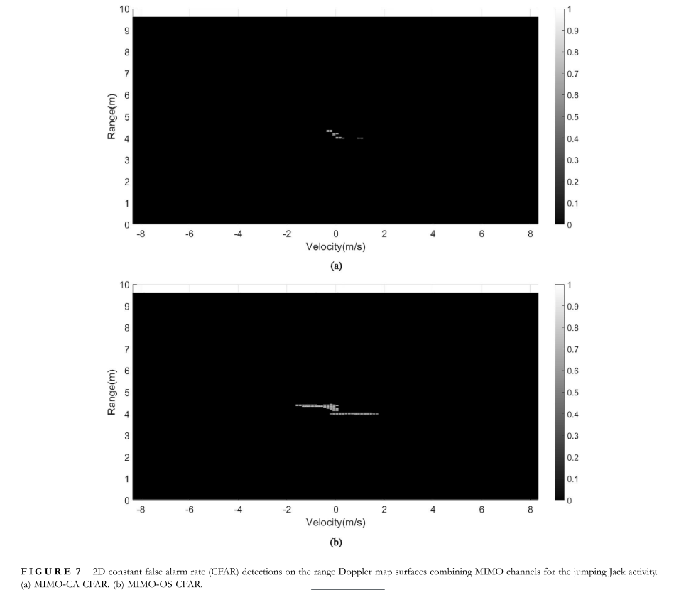
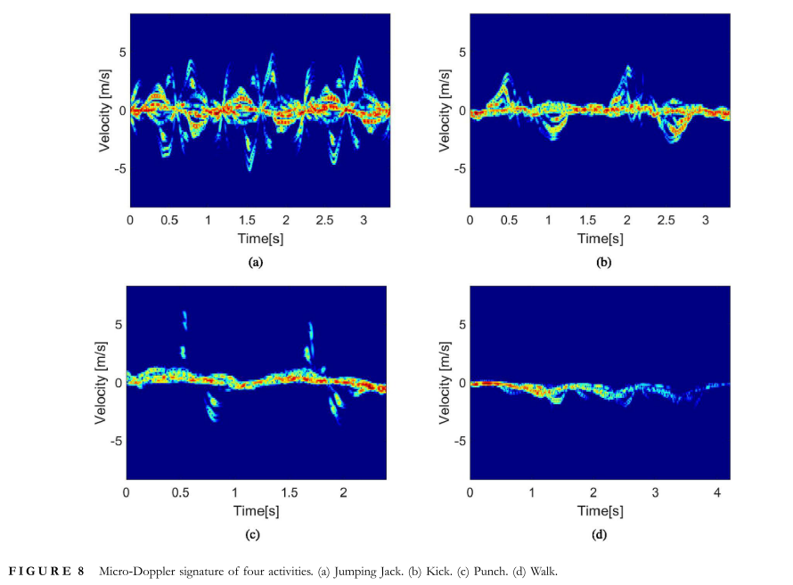
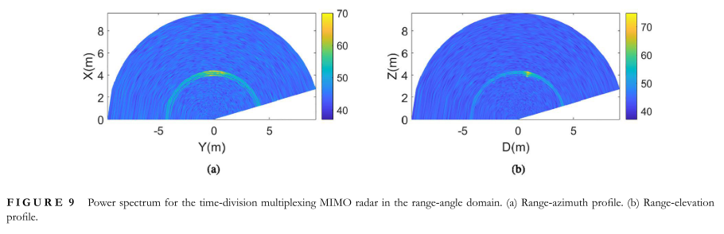
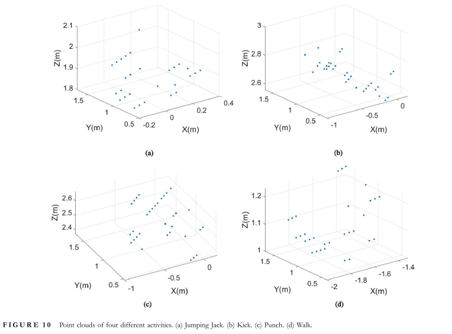
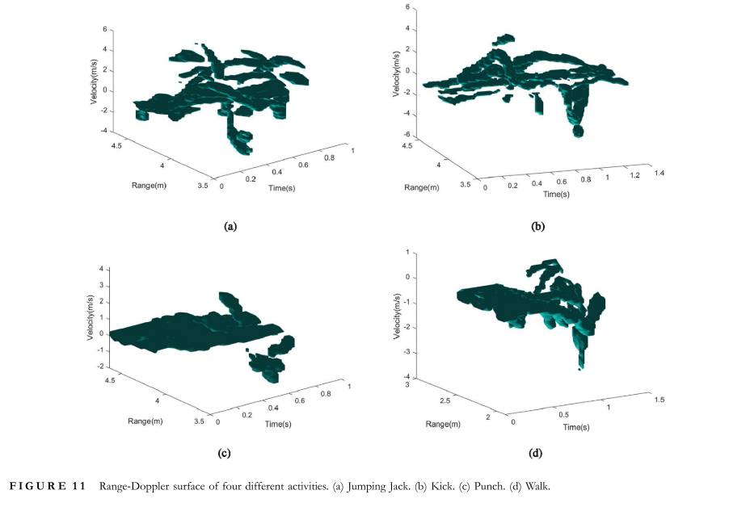
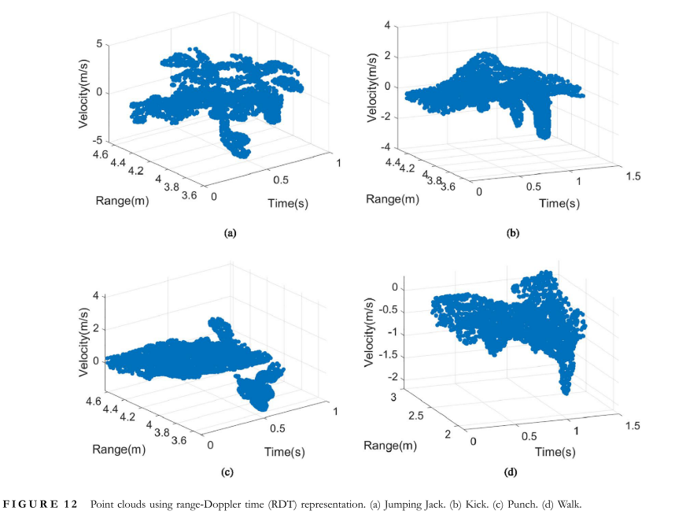
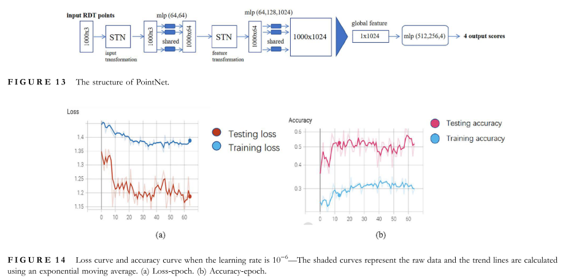
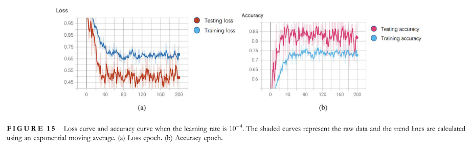
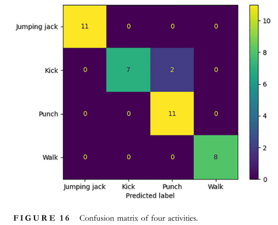
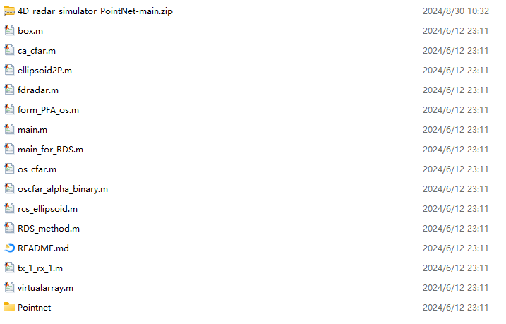

<!-- PAYMENT_BLOCK -->

## Get this dataset

- Payment link (Stripe): [Buy now](https://buy.stripe.com/3cs8yP7sY87d0vu9AB)
- Payment QR code: 

<!-- /PAYMENT_BLOCK -->
